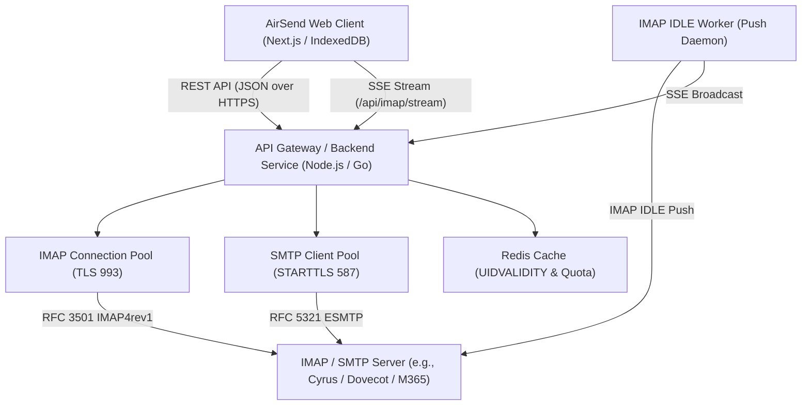

# AirSend IMAP Webmail — Backend Implementation Specification & API Contract

This document provides the complete, production-grade technical specification for building the backend service that powers the AirSend webmail frontend. It covers all REST endpoints, SSE streams, request payloads, response schemas, TypeScript data types, and IMAP/SMTP protocol mappings.

---

## 1. System Architecture Overview



### Key Architectural Patterns
1. **Two-Tier Payload Fetching**:
   - **Tier 1 (Metadata List)**: `/api/fetch-emails` fetches lightweight headers and snippets (`MailMessageMetadata`) without heavy message bodies. This allows 0-latency list rendering and virtualized scrolling.
   - **Tier 2 (Body on Demand)**: `/api/fetch-email-body` fetches and sanitizes the full HTML/plain-text body and inline attachments only when the user opens the message.
2. **Offline-First Resilience**:
   - The frontend caches fetched messages in browser IndexedDB via `@enjoys/react-api/idb`. The backend must provide consistent `UID`, `UIDVALIDITY`, and `cachedAt`/`updatedAt` timestamps.
3. **IMAP IDLE & Push Notifications**:
   - Persistent IMAP IDLE connections monitor the user's mailboxes and push real-time updates over Server-Sent Events (`/api/imap/stream`).

---

## 2. Authentication & Account Management

### 2.1 List Configured Accounts
- **Endpoint**: `GET /api/accounts`
- **Headers**: `Authorization: Bearer <token>`
- **Response Status**: `200 OK`
- **Response Schema**:
```json
[
  {
    "id": "acc-1",
    "displayName": "Mulayam Singh",
    "email": "mullayam06@outlook.com",
    "userName": "mullayam06@outlook.com",
    "accountType": "Microsoft 365",
    "imapHost": "outlook.office365.com",
    "imapPort": 993,
    "imapSecurity": "SslOnConnect",
    "smtpHost": "smtp.office365.com",
    "smtpPort": 587,
    "smtpSecurity": "StartTls",
    "isDefault": true,
    "requiresSignIn": false
  }
]
```

### 2.2 Add / Connect New Account
- **Endpoint**: `POST /api/accounts`
- **Request Headers**: `Content-Type: application/json`, `Authorization: Bearer <token>`
- **Request Body Schema**:
```json
{
  "displayName": "Work Mail",
  "email": "alex.morgan@contoso.com",
  "provider": "IMAP",
  "imapHost": "mail.contoso.com",
  "imapPort": 993,
  "imapSecurity": "SslOnConnect",
  "imapUsername": "alex.morgan@contoso.com",
  "imapPassword": "app-password-secure",
  "useSameAuth": true,
  "smtpHost": "smtp.contoso.com",
  "smtpPort": 587,
  "smtpSecurity": "StartTls",
  "smtpUsername": "alex.morgan@contoso.com",
  "smtpPassword": "app-password-secure"
}
```
- **Backend Behavior**:
  1. Opens TLS connection to `imapHost:imapPort` and issues `LOGIN`.
  2. Opens socket to `smtpHost:smtpPort` and verifies `EHLO` + `AUTH LOGIN`.
  3. Encrypts credentials with AES-256-GCM before saving in the database.
- **Response Status**: `201 Created`

---

## 3. Mailbox Folders & Hierarchy

### 3.1 Fetch Mailboxes (IMAP LIST)
- **Endpoint**: `GET /api/fetch-mailboxes?accountId=:accountId`
- **Response Status**: `200 OK`
- **Response Schema**:
```json
[
  {
    "id": "fld-inbox",
    "accountId": "acc-1",
    "fullName": "INBOX",
    "displayName": "Inbox",
    "parentFullName": null,
    "special": "Inbox",
    "uidValidity": 20261113,
    "unreadCount": 3,
    "totalCount": 24,
    "lastSyncedAt": "2026-11-13T21:40:00.000Z",
    "sortRank": 1
  },
  {
    "id": "fld-archive",
    "accountId": "acc-1",
    "fullName": "Archive",
    "displayName": "Archive",
    "parentFullName": null,
    "special": "Archive",
    "uidValidity": 20261113,
    "unreadCount": 0,
    "totalCount": 142,
    "lastSyncedAt": "2026-11-13T21:38:00.000Z",
    "sortRank": 2
  },
  {
    "id": "fld-sent",
    "accountId": "acc-1",
    "fullName": "Sent Items",
    "displayName": "Sent Items",
    "parentFullName": null,
    "special": "Sent",
    "uidValidity": 20261113,
    "unreadCount": 0,
    "totalCount": 58,
    "lastSyncedAt": "2026-11-13T21:38:00.000Z",
    "sortRank": 3
  },
  {
    "id": "fld-deleted",
    "accountId": "acc-1",
    "fullName": "Deleted Items",
    "displayName": "Deleted Items",
    "parentFullName": null,
    "special": "Trash",
    "uidValidity": 20261113,
    "unreadCount": 0,
    "totalCount": 8,
    "lastSyncedAt": "2026-11-13T21:38:00.000Z",
    "sortRank": 4
  },
  {
    "id": "fld-junk",
    "accountId": "acc-1",
    "fullName": "Junk Email",
    "displayName": "Junk Email",
    "parentFullName": null,
    "special": "Junk",
    "uidValidity": 20261113,
    "unreadCount": 1,
    "totalCount": 5,
    "lastSyncedAt": "2026-11-13T21:38:00.000Z",
    "sortRank": 5
  }
]
```

### 3.2 Create Folder
- **Endpoint**: `POST /api/folders`
- **Request Body**:
```json
{
  "accountId": "acc-1",
  "name": "Projects",
  "parentFolderId": null
}
```
- **IMAP Command**: `CREATE "Projects"`
- **Response Status**: `201 Created`

### 3.3 Empty Folder (Trash / Junk Expunge)
- **Endpoint**: `POST /api/folders/:id/empty`
- **IMAP Command**: Select folder, `STORE 1:* +FLAGS (\Deleted)`, `EXPUNGE`.
- **Response**: `{"deletedCount": 8}`

---

## 4. Message Operations & Data Schemas

### 4.1 Fetch Email Metadata List (Tier 1)
- **Endpoint**: `GET /api/fetch-emails?folderId=:folderId&accountId=:accountId&offset=0&limit=50`
- **Response Status**: `200 OK`
- **Response Schema (`MailMessageMetadata[]`)**:
```json
[
  {
    "id": "msg-whitekraaft",
    "folderId": "fld-inbox",
    "accountId": "acc-1",
    "uid": 1024,
    "messageIdHeader": "<wk-rec-20261113-001@whitekraaft.com>",
    "threadId": "thread-recruitment-01",
    "subject": "Executive Search Opportunity — Principal Infrastructure Engineer",
    "fromName": "Whitekraaft Recruitment",
    "fromAddress": "recruitment@whitekraaft.com",
    "to": "mullayam06@outlook.com",
    "date": "2026-11-13T20:15:00.000Z",
    "size": 24576,
    "preview": "We are reaching out on behalf of an enterprise fintech client regarding a Principal Infrastructure role...",
    "isRead": true,
    "isFlagged": false,
    "isPinned": false,
    "isAnswered": false,
    "isForwarded": false,
    "isDraft": false,
    "isThread": true,
    "threadCount": 2,
    "hasAttachments": true,
    "hasCalendar": false,
    "bimiLogoUrl": "https://img.logo.dev/whitekraaft.com?token=pk_demo",
    "bimiVerified": true
  }
]
```

### 4.2 Fetch Email Body on Demand (Tier 2)
- **Endpoint**: `GET /api/fetch-email-body?messageId=:messageId`
- **Backend Behavior**:
  1. Fetches raw RFC-822 MIME tree via `FETCH <UID> (BODY.PEEK[])`.
  2. Extracts HTML and plain text parts.
  3. Replaces `cid:<content-id>` references with `/api/attachments/:id/inline`.
  4. Sanitizes HTML with DOMPurify (strips active script tags, isolates styles).
- **Response Status**: `200 OK`
- **Response Schema**:
```json
{
  "bodyHtml": "<div style=\"font-family: Arial, sans-serif;\"><p>Dear Mulayam,</p><p>We are pleased to introduce an opportunity...</p></div>",
  "bodyText": "Dear Mulayam,\n\nWe are pleased to introduce an opportunity..."
}
```

### 4.3 Send Email (SMTP + IMAP Sent Append)
- **Endpoint**: `POST /api/send-email`
- **Request Body (`SendEmailPayload`)**:
```json
{
  "to": "jeelan.shaik@recruitment.com",
  "cc": "hiring@recruitment.com",
  "bcc": "mullayam06@outlook.com",
  "subject": "Re: Technical Interview Confirmation",
  "bodyHtml": "<p>Hi Jeelan,<br/><br/>I confirm my availability for tomorrow at 2:00 PM IST.</p>",
  "attachments": []
}
```
- **Backend Flow**:
  1. Builds MIME message (`multipart/alternative` or `multipart/mixed`).
  2. Connects to account's SMTP server via TLS and delivers message.
  3. Appends copy to account's `Sent Items` folder via IMAP `APPEND "Sent Items" (\Seen) {size}`.
- **Response Status**: `200 OK`
- **Response**: `{"success": true, "id": "sent-1794582991000"}`

### 4.4 Flag / Read / Move Operations
| Action | Endpoint | Method | IMAP Protocol Mapping |
| :--- | :--- | :--- | :--- |
| **Mark as Read** | `/api/emails/:id/read` | `PATCH` | `UID STORE <UID> +FLAGS (\Seen)` |
| **Mark as Unread** | `/api/emails/:id/unread` | `PATCH` | `UID STORE <UID> -FLAGS (\Seen)` |
| **Toggle Flag (Star)** | `/api/emails/:id/flag` | `PATCH` | `UID STORE <UID> (+/-)FLAGS (\Flagged)` |
| **Move to Folder** | `/api/emails/move` | `POST` | `UID MOVE <UID> "<TargetFolder>"` |
| **Bulk Move** | `/api/emails/bulk-move` | `POST` | `UID MOVE <UID1,UID2,...> "<TargetFolder>"` |
| **Delete Message** | `/api/emails/:id` | `DELETE` | `UID MOVE <UID> "Deleted Items"` or `\Deleted` + `EXPUNGE` |

---

## 5. Real-Time Push Events via Server-Sent Events (SSE)

- **Endpoint**: `GET /api/imap/stream?accountId=:accountId`
- **Headers**: `Accept: text/event-stream`, `Cache-Control: no-cache`
- **Event Stream Protocol**:
```
event: connected
data: {"status":"connected","accountId":"acc-1","timestamp":"2026-11-13T21:40:00.000Z"}

event: new_mail
data: {"folderId":"fld-inbox","message":{"id":"msg-new-001","subject":"Team Weekly Sync","fromName":"Satya Nadella","fromAddress":"satya@microsoft.com","date":"2026-11-13T21:42:00.000Z","isRead":false,"preview":"Agenda for tomorrow's standup..."}}

event: flags_changed
data: {"messageId":"msg-whitekraaft","isRead":true,"isFlagged":false}

event: message_deleted
data: {"folderId":"fld-inbox","messageId":"msg-102"}

event: quota_update
data: {"usedMb":4235,"totalMb":15360,"pct":28}
```

---

## 6. Mailbox Quota & Rules

### 6.1 Mailbox Storage Quota (RFC 2087)
- **Endpoint**: `GET /api/accounts/:id/quota`
- **Response**:
```json
{
  "usedMb": 4235,
  "totalMb": 15360,
  "percentage": 28,
  "breakdown": {
    "inboxMb": 2840,
    "sentMb": 980,
    "archiveMb": 380,
    "trashMb": 35
  }
}
```

### 6.2 Filter Rules & Policies
- **Endpoint**: `GET /api/settings/rules?accountId=:accountId`
- **Response**:
```json
[
  {
    "id": "rule-recruitment",
    "name": "Move Recruitment Emails to Career Folder",
    "enabled": true,
    "condition": "from contains 'recruitment.com'",
    "action": "moveTo 'Careers'"
  }
]
```

---

## 7. Error Handling & Standard Responses

All errors returned by the API conform to RFC 7807 (Problem Details for HTTP APIs):
```json
{
  "type": "https://errors.airsend.in/imap-auth-failed",
  "title": "Authentication Failed",
  "status": 401,
  "detail": "Invalid credentials provided for imap.airsend.in:993",
  "instance": "/api/accounts/acc-1/test-connection",
  "code": "IMAP_AUTHENTICATION_FAILED",
  "retryable": false
}
```
Common Error Codes:
- `IMAP_CONNECTION_TIMEOUT`: Remote server did not respond within 10 seconds.
- `MAILBOX_LOCKED`: Another IMAP client holds an exclusive lock on this mailbox.
- `QUOTA_EXCEEDED`: Storage limit reached.
- `SMTP_DELIVERY_FAILED`: Recipient mailbox rejected message.
