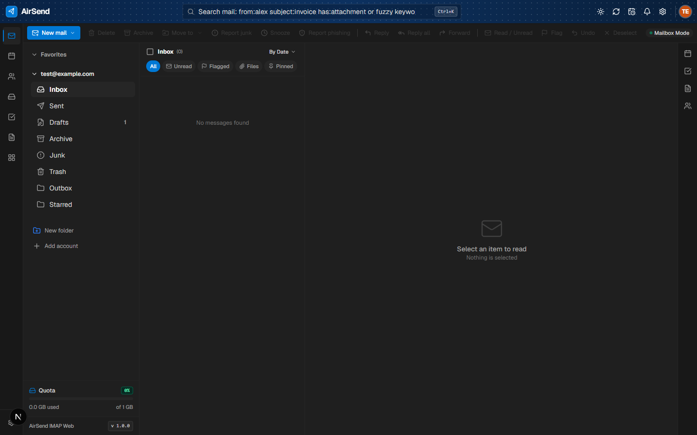
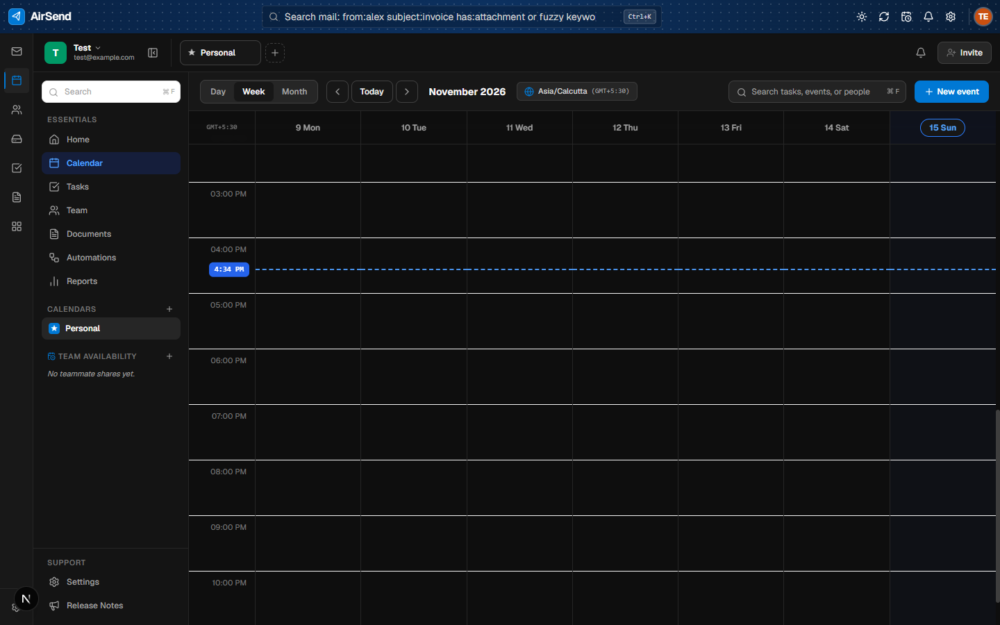
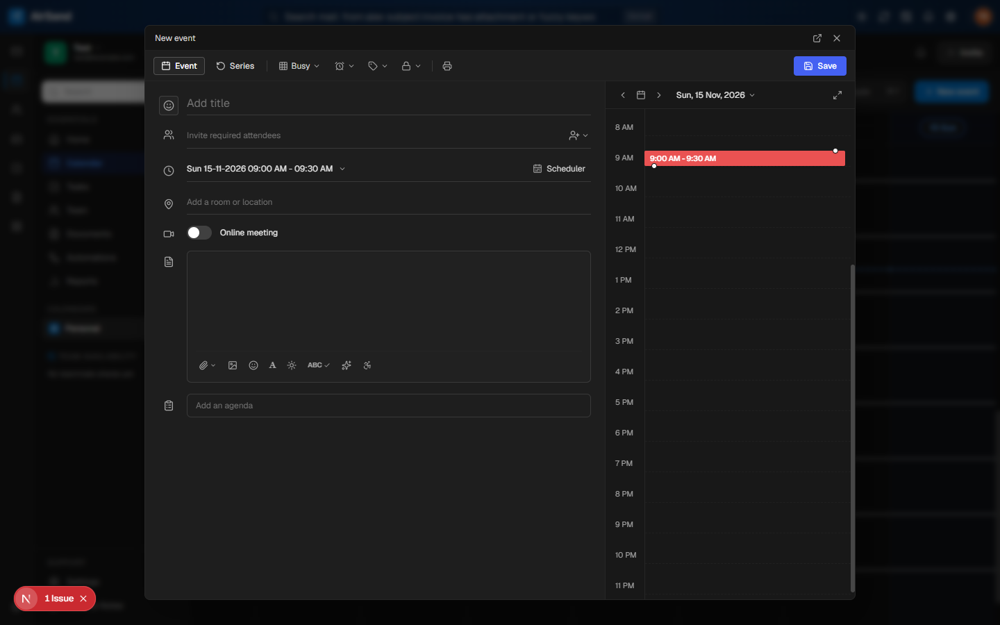
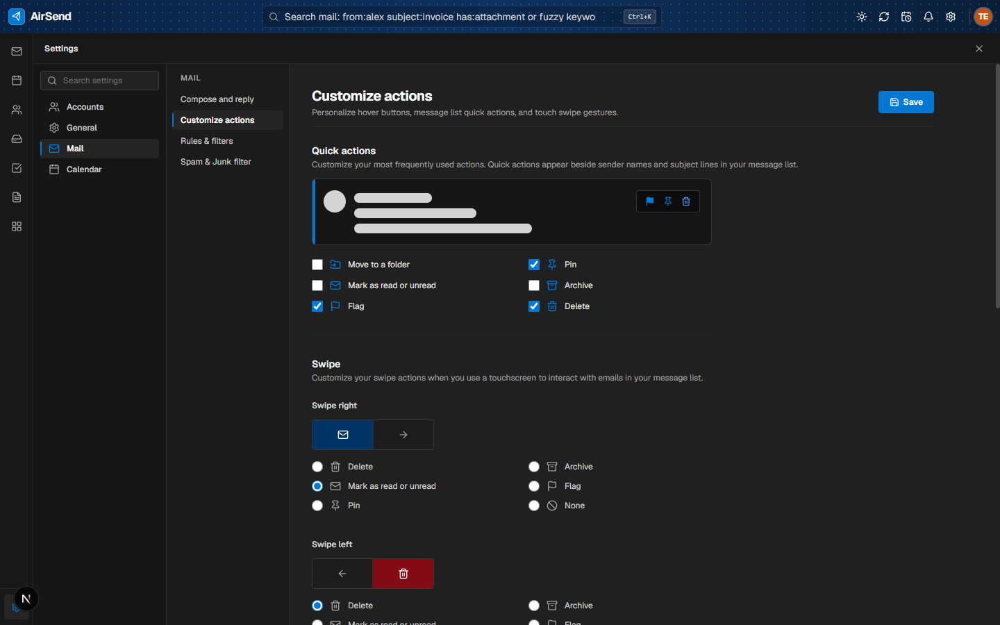
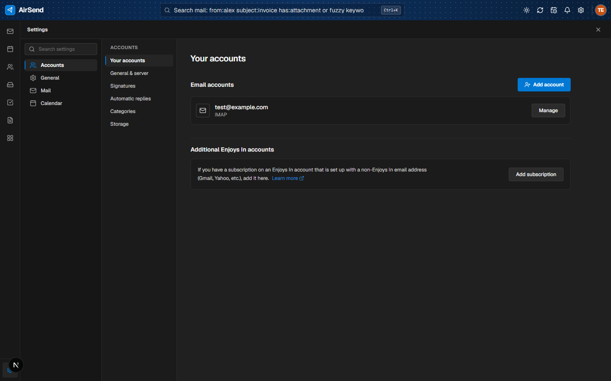

# AirSend Web Mail & Calendar Client

A high-performance, Fluent UI-inspired Web Mail and Calendar client built with **Next.js (App Router)**, **Tailwind CSS v4**, **Zustand**, **TanStack React Query**, and native browser storage via **IndexedDB** (`@enjoys/react-api/idb`). Designed to mirror Microsoft 365 / Outlook with real-time IMAP/SMTP synchronization, calendar scheduling, and configurable notification dispatchers.

---

## Visual Showcase

### 1. Modern Web Mail Interface
Three-pane responsive workspace featuring a multi-account folder tree, virtualized email list, conversation reading pane, command toolbar, and docked quota monitor.



---

### 2. Calendar Studio
Full-featured scheduling studio with 7-day week, month, and single-day views, color-coded appointment tags, time-slot selection, and unread reminder badge integration.



---

### 3. Fluent "New Event" Creation Dialog
Detailed two-column event composer replicating Microsoft 365:
- **Left Column**: Title charm selector, required attendee invites, inline date/time picker, room/location, Microsoft Teams meeting toggle, rich description notes editor with formatting toolbar, and agenda composer.
- **Right Column**: Live interactive mini-day schedule canvas with draggable & resizable coral-red event blocks (30-minute default duration, circular drag handles, and snap-to-slot interaction).



---

### 4. Notification & Gesture Customization
Granular personalization for mail interactions and notifications:
- **Hover Quick Actions**: Configure up to 4 quick action pills on message rows (move, pin, read/unread, archive, flag, delete).
- **Touch Swipe Gestures**: Set custom swipe-left and swipe-right actions.
- **In-App Notification Buttons**: Choose up to 2 action buttons (Open, Mark as read, Delete, Archive, Flag) with live interactive toast previews.
- **Web Push Notification Buttons**: Configure up to 2 action buttons for desktop OS system push notifications with live desktop banner preview cards.



---

### 5. Multi-Account & Server Management
Manage multiple email accounts, IMAP/SMTP connection security (TLS/SSL), autodiscovery, storage quotas, and synchronization preferences.



---

## Core Capabilities

- **Real-Time Mailbox Sync**: Powered by Server-Sent Events (SSE) stream listener (`LiveEmailSyncBridge.tsx`) and periodic background sync for folder status, message flags, and expunged emails.
- **Offline First**: Fast caching using IndexedDB for offline message navigation, folder caching, and calendar appointments.
- **Smart Notification Dispatcher**:
  - Automatically detects whether the user is actively viewing the tab (`document.hasFocus()`).
  - Dispatches interactive in-app toasts with configurable action buttons when the tab is focused.
  - Triggers native desktop Web Push notifications (`public/sw.js`) with custom OS action buttons when backgrounded.
- **Today's Meetings Sidebar**:
  - Automatically displays current/upcoming appointments for today.
  - Automatically hides completely when there are no appointments today.
  - Features smooth animated CSS grid collapse/expand transitions and one-click "Join" buttons for Teams, Google Meet, and Zoom links.
- **Fluent UI Theme**: Dark mode, light mode, and high-contrast styling with Segoe UI typography and Microsoft 365 visual design.

---

## Technology Stack

| Layer | Technology |
|---|---|
| **Framework** | [Next.js](https://nextjs.org) (App Router, Turbopack) |
| **Language** | TypeScript |
| **Styling** | [Tailwind CSS v4](https://tailwindcss.com) + Lucide Icons |
| **State Management** | [Zustand](https://github.com/pmndrs/zustand) (with local storage persistence) |
| **Data Fetching** | [TanStack React Query v5](https://tanstack.com/query/latest) |
| **Offline Cache** | IndexedDB via `@enjoys/react-api/idb` / Dexie |
| **Push Notifications** | Web Push API + Service Worker (`public/sw.js`) |

---

## Getting Started

### Prerequisites
- Node.js 18.17+ or Node.js 20+
- pnpm 9+ or pnpm 10+ (recommended), npm, or yarn

### Installation

```bash
# Clone the repository
git clone https://github.com/enjoys/airsend-imap-web.git
cd imap-web

# Install dependencies
pnpm install
```

### Running the Development Server

```bash
pnpm dev
```

Open [http://localhost:3000](http://localhost:3000) in your browser.

---

## Project Structure

```
├── public/
│   ├── sw.js                 # Service worker for push notifications & action clicks
│   └── icons/                # PWA and app branding assets
├── src/
│   ├── app/                  # Next.js App Router pages
│   │   ├── mail/             # Mail inbox & message reading routes
│   │   ├── calendar/         # Calendar studio route
│   │   ├── people/           # Contacts & address book
│   │   ├── settings/         # Accounts, mail, and appearance settings
│   │   └── login/            # Fluent 3D sign-in & autodiscover setup
│   ├── components/           # Reusable UI components
│   │   ├── calendar/         # Calendar views, week grids, and CreateScheduleModal
│   │   ├── mail/             # Folder tree, message list, reading pane, compose
│   │   ├── notifications/    # ToastContainer, CalendarNotificationBell
│   │   └── settings/         # CustomizeActionsSettingsView, Accounts settings
│   ├── hooks/                # Custom React hooks (email stream, sync, notifications)
│   ├── lib/                  # APIs, SSE listeners, Web Push dispatcher, IndexedDB
│   ├── stores/               # Zustand state stores (general settings, mail, toast)
│   └── types/                # TypeScript interfaces and schema models
└── docs/
    └── screenshots/          # Captured UI screenshots
```

---

## License

Private and proprietary. Developed for the AirSend ecosystem.
